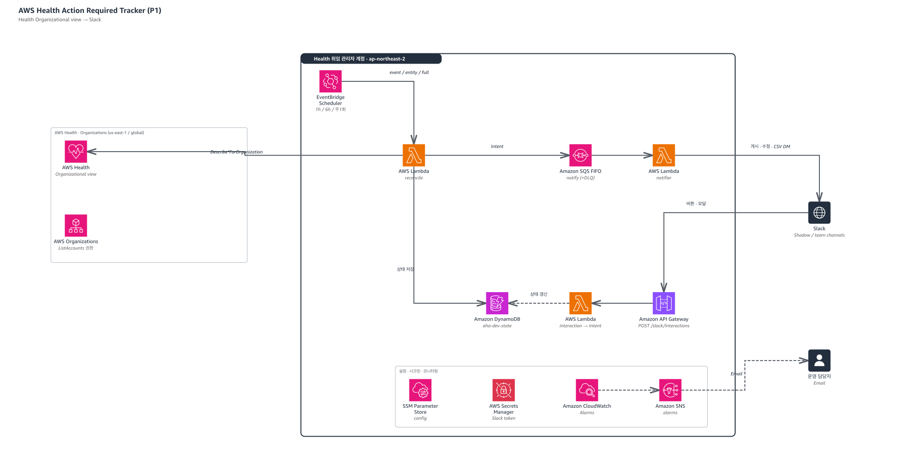

# aws-org-health-aware

AWS Health Organizational view에서 조치가 필요한 이벤트(ACTION_REQUIRED / ACTION_MAY_BE_REQUIRED)를 계정 단위로 추적하고 Slack으로 알린다.

- 설계: `docs/specs/2026-10-12-health-action-required-slack-design.md`
- P1 구현 계획: `docs/plans/2026-10-12-health-ar-slack-p1-mvp.md`

## 아키텍처



| 구성 요소 | 역할 |
|---|---|
| EventBridge Scheduler | reconcile Lambda를 주기 실행: event sweep 1시간, entity sweep 6시간, full resync 주 1회 (Asia/Seoul). reminder Lambda는 매일 09:00 KST |
| Lambda `reconcile` | AWS Health Organizational view API(us-east-1, 읽기 전용)로 이벤트·영향 계정·리소스를 조회해 상태를 반영하고, 변경을 Intent로 발행 |
| DynamoDB `state` | 이벤트, 이벤트 그룹, 계정별 추적 항목, 리소스, 감사 로그, Slack Notice, 커서 (단일 테이블) |
| SQS FIFO `notify` (+DLQ) | Intent 큐. 이벤트 그룹 단위 순서 보장, CSV 내보내기는 별도 그룹 |
| Lambda `notifier` | 이벤트 그룹 × 채널당 Slack 메시지 1개 게시·수정, 스레드 기록, CSV를 요청자 DM으로 전송 |
| Lambda `reminder` | 매일 09:00 KST: 담당자 미지정 항목에 계정 이메일(Organizations) 기준 담당자 자동 지정, OPEN 항목의 마일스톤(D-90…D-day)·기한 경과(D+1, 이후 매주 월요일) 리마인더를 Intent로 발행 |
| API Gateway + Lambda `interaction` | Slack 버튼·모달 처리(서명 검증) → 상태 갱신 → Intent 발행 |
| SSM Parameter Store / Secrets Manager | 애플리케이션 설정 / Slack bot token·signing secret |
| CloudWatch Alarms → SNS | heartbeat, 누락, 미완료 실행, DLQ, Lambda 오류를 이메일로 통지 (Slack 장애와 무관한 경로) |

다이어그램 원본은 `docs/images/architecture.json`(AWS 공식 아키텍처 아이콘 기반)이며, 수정 후 SVG/PNG를 다시 생성한다.

## 데이터 모델 (DynamoDB `aha-{env}-state`)

여러 항목 유형을 키 접두사로 구분하는 **단일 테이블**이다. 구현: `src/aha/adapters/repo_dynamodb.py`.

- 키: `pk`(PK, String), `sk`(SK, String), 온디맨드 용량
- GSI `gsi-state`: `gsi1pk = STATE#{state}`, `gsi1sk = {due_date}#{tracking_id}`, 프로젝션 ALL — 상태별·Due Date 순 조회(리마인더, entity sweep)
- 보호: PITR, 삭제 보호, 서버 측 암호화

| 항목 | pk | sk | 주요 속성 |
|---|---|---|---|
| 이벤트 | `EVT#{eventArn}` | `META` | `group_id`, service, event_type_code, category, event_region, status_code, start/end/last_updated_time, actionability, personas, description, description_hash, dynamic_status |
| 이벤트 그룹 | `GRP#{groupId}` | `META` | correlation_key, primary_arn, event_arns(String Set) |
| 추적 항목(계정 단위) | `GRP#{groupId}` | `TRK#{accountId}` | 아래 표 참고 |
| Notice(Slack 메시지) | `GRP#{groupId}` | `NTC#{channelId}` | ts, posted_channel_id(대체 채널 게시 시 실제 채널) |
| 리소스 | `TRK#{groupId}#{accountId}` | `ENT#{entityValue}` | status(PENDING/RESOLVED/UNKNOWN…), last_seen_at |
| 감사 로그 | `TRK#{groupId}#{accountId}` | `LOG#{ISO8601}#{rand}` | actor(Slack 사용자 ID 또는 `system`), action, before, after, detail |
| 커서·마커 | `CURSOR` | `event`, `EVTSWEPT#{eventArn}` | value(ISO8601) |

추적 항목 속성:

| 속성 | 설명 |
|---|---|
| `tier` | `TIER1`(ACTION_REQUIRED) / `TIER2`(ACTION_MAY_BE_REQUIRED) |
| `state` | `TRIAGE` / `OPEN` / `RESOLVED_AUTO` / `RESOLVED_MANUAL` / `NOT_APPLICABLE` / `CLOSED_BY_AWS` |
| `due_date`, `due_date_source`, `aws_due_date` | 현재 Due Date, 출처(`AWS`/`DEFAULT_SLA`/`MANUAL`), AWS 기준 날짜 |
| `assignee` | 담당자 Slack 사용자 ID (수동 지정 또는 계정 이메일 alias 기반 자동 지정) |
| `event_arns` | 연결된 eventArn 목록 (분할 이벤트 포함) |
| `reminders_sent` | 발송한 리마인더 키 (`BASELINE`, `D-30`, `D-0`, `OVERDUE-1`, `OVERDUE-YYYY-Www`) |
| `manual_completion_required`, `verification_mismatch` | 자동 완료 판정 미지원 여부, 수동 완료 후 72시간 불일치 플래그 |
| `counts` | `{pending, resolved, total}` 리소스 집계 |
| `created_at`, `resolved_at`, `manual_resolved_at` | 생성·종결 시각 |
| `version` | 낙관적 잠금(조건부 쓰기) 버전 |

식별자 규칙:
- `groupId = sha256("{eventTypeCode}#{eventRegion}#{변경일(YYYY-MM-DD)}")[:16]` — 같은 유형·리전·변경일의 이벤트(분할된 eventArn 포함)가 한 그룹이 된다. 기존 eventArn은 `EVT#` 항목에 저장된 `group_id`를 따른다.
- `trackingId = {groupId}#{accountId}`

주요 조회 패턴:

| 용도 | 방법 |
|---|---|
| 그룹의 계정별 항목 / Notice | `pk = GRP#{groupId}` + `sk begins_with TRK#` / `NTC#` |
| 항목의 리소스 / 감사 로그 | `pk = TRK#{trackingId}` + `sk begins_with ENT#` / `LOG#` |
| 상태별 대상(리마인더, sweep) | GSI `gsi-state`, `gsi1pk = STATE#OPEN` (Due Date 순) |
| eventArn → 그룹 | `EVT#{eventArn}` 항목의 `group_id` |

날짜·시각은 ISO 문자열, 집합 값은 정렬된 리스트로 저장한다(그룹 `event_arns`만 동시 병합을 위해 String Set).

## 개발

```bash
python3.12 -m venv .venv && . .venv/bin/activate
pip install -e '.[dev]'
pytest -q
```

## 배포 (dev, Health 위임 관리자 계정)

> 모든 단계는 Health 위임 관리자 계정 자격 증명으로 실행한다. 관리 계정에 배포하지 않는다.
> `terraform apply`는 변경 내역(`plan`)을 검토하고 승인한 뒤에만 실행한다.

1. Slack App 생성: `slack/manifest.yaml`로 앱을 만들고 워크스페이스에 설치한다. Bot token(`xoxb-`)과 Signing secret을 확인한다.
2. 시크릿 생성 (값은 셸 히스토리에 남지 않도록 파일로 전달):
   ```bash
   aws secretsmanager create-secret --name aha/dev/slack --secret-string file://slack-secret.json
   # slack-secret.json: {"bot_token": "xoxb-...", "signing_secret": "..."}
   ```
3. `infra/envs/dev/config.yaml`의 `default_channel`, `shadow_channel`을 실제 채널 ID로 바꾼다.
4. 빌드와 계획:
   ```bash
   ./scripts/build_lambda.sh
   terraform -chdir=infra/envs/dev init
   terraform -chdir=infra/envs/dev plan -var slack_secret_arn=<ARN> -var alarm_email=<EMAIL> -out tfplan
   ```
5. 계획 검토 후 적용: `terraform -chdir=infra/envs/dev apply tfplan`
6. `terraform output interaction_url` 값을 Slack App의 Interactivity Request URL에 설정한다.
7. SNS 구독 확인 메일을 승인한다.

배포 시 참고:

- 최초 배포 후 몇 시간 동안은 reconcile 실행 이력이 쌓이지 않아 heartbeat 알람이 한 번 울릴 수 있다. 첫 sweep이 성공하면 해소된다. `reminder-heartbeat` 알람도 첫 09:00 KST 실행 전까지 울릴 수 있다.
- Slack 시크릿을 고객 관리형 KMS 키(CMK)로 암호화했다면 notifier/interaction Lambda 역할에 해당 키의 `kms:Decrypt` 권한을 추가해야 한다.
- dev DynamoDB 테이블은 삭제 보호(`deletion_protection_enabled`)가 켜져 있다. `terraform destroy` 전에 명시적으로 해제해야 한다.
- CSV 내보내기를 쓰려면 Slack App에 `files:write`, `im:write` 스코프가 필요하다. 스코프를 추가한 뒤 워크스페이스에 앱을 다시 설치한다. Bot token이 바뀌면 Secrets Manager 시크릿을 `put-secret-value`로 갱신하고, 이미 떠 있는(warm) Lambda는 콜드 스타트 전까지 이전 토큰을 유지하므로 재배포하거나 함수 설정을 업데이트해 갱신한다.
- 리마인더와 담당자 자동 지정을 쓰려면 Slack App에 `users:read.email` 스코프가 필요하다(`slack/manifest.yaml` 반영됨). 스코프를 추가한 뒤 워크스페이스에 앱을 다시 설치하고, Bot token이 바뀌면 위와 같이 시크릿을 갱신한다.
- `reminder` Lambda는 매일 09:00 KST에 실행된다. 첫 실행은 기존 항목의 이미 지난 마일스톤을 기록만 하고 리마인더를 보내지 않는다(알림 폭주 없음). 대신 담당자가 없는 항목에는 계정 이메일 alias(`+접미사` 제거, 소문자) + `owner_email_domain`(기본 `amazon.com`)으로 Slack 사용자를 찾아 담당자를 자동 지정하고 스레드에 남긴다. 찾지 못하면 미지정으로 둔다.
- 프로바이더 버전은 `infra/envs/dev/.terraform.lock.hcl`로 고정되어 있다. 업그레이드는 `init -upgrade` 후 lock 파일 변경을 검토해 커밋한다.

## 섀도 운영 (P1, 2주)

- 모든 알림은 `shadow_channel` 하나로 간다.
- 매일 Health 메일 수신 내역과 섀도 채널을 대조해 누락·중복을 기록한다.
  - 누락: 메일에는 있으나 채널에 없는 ACTION_REQUIRED 이벤트
  - 중복: 같은 이벤트에 대해 채널에 메시지가 2개 이상
- 첫 주에 실제 이벤트 페이로드에서 `actionability`, `personas` 값이 채워지는지 확인한다 (spec Q1).
- 완료 기준: 2주간 누락 0건, 중복 메시지 0건.

## 운영 점검

| 알람 | 의미 | 조치 |
|---|---|---|
| `*-reconcile-heartbeat` | event sweep 3시간 이상 실패 | reconcile Lambda 로그 확인 (Health API 권한/스로틀링) |
| `*-reconcile-missed-items` | 주간 full resync에서 누락 발견 | event sweep 커서·필터 점검 |
| `*-reconcile-incomplete-{full,entity}` | full/entity sweep이 Lambda 시간 예산(종료 60초 전) 소진으로 중단됨 | reconcile 로그에서 처리량·Health API 지연 확인. 이벤트/항목 수가 많으면 sweep 분할 또는 주기 조정 검토 |
| `*-notify-dlq-not-empty` | Slack 게시 5회 실패 | DLQ 메시지 확인 후 원인 해결, SQS 콘솔의 DLQ redrive로 재처리 |
| `*-reminder-heartbeat` | 일일 리마인더가 이틀 연속 성공하지 않음 | reminder Lambda 로그 확인 (Slack `users:read.email` 스코프, Organizations 권한) |
| `*-<fn>-errors` | Lambda 오류 | 해당 함수 로그 확인 |
